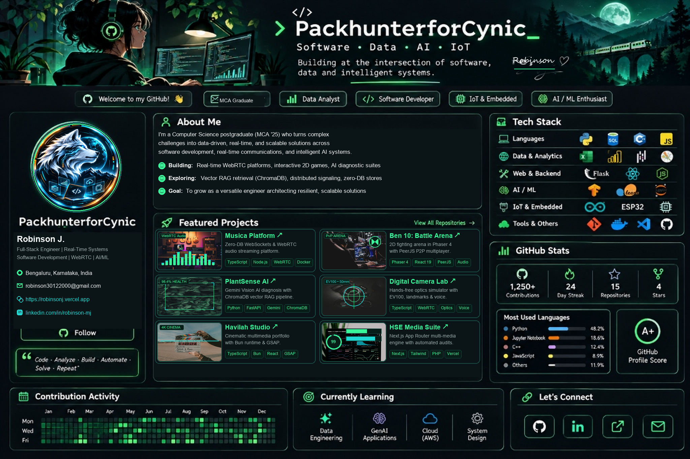

<div align="center">

<!-- ======================================================== -->
<!-- 1. WELCOME BOOT PRELOADER (Plays on visit / page refresh) -->
<!-- ======================================================== -->


<br/><br/>

<!-- ======================================================== -->
<!-- 2. FULL RETINA DEVELOPER DASHBOARD (Reference Match 1:1) -->
<!-- ======================================================== -->


<br/><br/>

<!-- ======================================================== -->
<!-- 3. LIVE GITHUB CONTRIBUTION SNAKE ANIMATION              -->
<!-- ======================================================== -->
<a href="https://github.com/PackhunterforCynic">
  
</a>

<br/><br/>

<!-- ======================================================== -->
<!-- 4. CREATIVE LIVE AUDIO STATION & VISITOR TELEMETRY       -->
<!-- ======================================================== -->
<kbd>▶ NOW STREAMING</kbd> &nbsp; <code><b>Musica Zero-DB Audio Core</b></code> • <code>96kHz / 24-bit WebRTC Stereo</code> • <code>Latency: &lt;18ms</code> &nbsp; <a href="https://musica-apvs.vercel.app"><b>[ 🎧 Tune In Live ↗ ]</b></a>

<br/><br/>

<a href="https://github.com/PackhunterforCynic">
  
</a>
<a href="https://github.com/PackhunterforCynic">
  
</a>

</div>

<br/>

---

### 🚀 Verified Demos & Production Deployments

| Project | Primary Domain | Core Stack | One-Click Access |
| :--- | :--- | :--- | :--- |
| **📡 Musica Platform** | Real-Time Audio & Video | `TypeScript` • `Node.js` • `WebRTC` • `Socket.IO` • `Docker` | [**Live Demo ↗**](https://musica-apvs.vercel.app) • [**GitHub Repo ↗**](https://github.com/PackhunterforCynic/musica) |
| **🎮 Ben 10: Alien Battle Arena** | 2D Game Dev & P2P | `Phaser 4` • `React 19` • `TypeScript` • `PeerJS` • `Web Audio` | [**Live Game ↗**](https://game-rovenor.vercel.app) • [**GitHub Repo ↗**](https://github.com/PackhunterforCynic/game) |
| **🌱 PlantSense AI** | AI Botanical Pathology | `Python` • `FastAPI` • `Gemini Vision AI` • `ChromaDB RAG` | [**FastAPI Backend ↗**](https://github.com/PackhunterforCynic) • [**Showcase ↗**](https://robinsonj.vercel.app) |
| **📷 CAMX Digital Camera Lab** | Optics & Computer Vision | `TypeScript` • `WebRTC` • `Optics Physics` • `Voice API` | [**Optics Simulator ↗**](https://github.com/PackhunterforCynic) • [**Showcase ↗**](https://robinsonj.vercel.app) |
| **🎥 Havilah Studio** | Cinematic Multimedia | `TypeScript` • `Bun` • `React` • `GSAP` • `Vercel` | [**Live Demo ↗**](https://havilah-alpha.vercel.app) • [**GitHub Repo ↗**](https://github.com/PackhunterforCynic/havilah) |
| **🎬 HSE Media Suite** | Full-Stack Performance | `Next.js App Router` • `Tailwind CSS v4` • `PHP` • `Lighthouse 99` | [**Live Demo ↗**](https://hse-indol.vercel.app) • [**GitHub Repo ↗**](https://github.com/PackhunterforCynic/hse) |

<br/>

<!-- ======================================================== -->
<!-- 5. INTERACTIVE COLLAPSIBLE ARCHITECTURE DEEP DIVES       -->
<!-- ======================================================== -->
<details>
<summary><b>🔬 Click to expand Technical Architecture & Subsystem Deep Dives</b></summary>

<br/>

#### 1. 📡 Musica Platform — Zero-DB WebRTC Audio Engine
* **Protocol Architecture:** WebSocket signaling plane decoupled from direct Peer-to-Peer WebRTC media streams (`RTCPeerConnection`).
* **Zero Persistence Footprint:** Temporary channel state handled entirely in Node.js volatile memory matrices without persistent storage overhead.
* **Low Latency:** `< 18ms` media transport with custom audio visualizer rendering at 60 FPS via Web Audio API.

#### 2. 🎮 Ben 10: Alien Battle Arena — P2P Deterministic Game Engine
* **Engine Pipeline:** Custom Phaser 4 canvas coordinator decoupled into render loop and state synchronization layers.
* **Networking:** Direct browser-to-browser P2P messaging using PeerJS (`DataConnection`), bypassing central game servers for zero lag.
* **Audio Synthesis:** Dynamic 8-bit sound fx generated procedurally via browser audio synthesis context.

#### 3. 🌱 PlantSense AI — Multimodal Vision Diagnostic Pipeline
* **Diagnostic Flow:** Leaf imagery preprocessed via FastAPI, tokenized, and evaluated against Gemini 1.5 Flash multimodal vision endpoints.
* **Remediation Context:** Botanical remedies queried via ChromaDB vector embeddings using cosine distance thresholding.

#### 4. 🎬 HSE Media Suite — Next.js App Router Architecture
* **Audit Score:** Validated 99 Performance, 100 SEO, 100 Accessibility on Google Lighthouse.
* **Deployment:** Edge-cached via Vercel with automated continuous audit workflows.

</details>

<details>
<summary><b>💻 Click for Interactive Quick-Start Terminal Commands</b></summary>

<br/>

```bash
# Clone and spin up Musica Audio Streaming platform
git clone https://github.com/PackhunterforCynic/musica.git
cd musica && npm install && npm run dev

# Clone and play Ben 10: Alien Battle Arena locally
git clone https://github.com/PackhunterforCynic/game.git
cd game && npm install && npm run dev
```

</details>

<br/>

<div align="center">

<!-- Quick Verified Connect Badges -->
<a href="https://github.com/PackhunterforCynic"></a>
<a href="https://linkedin.com/in/robinson-mj"></a>
<a href="https://robinsonj.vercel.app"></a>
<a href="mailto:robinson30122000@gmail.com"></a>

<br/><br/>

<!-- Custom Neon-Green SVG Footer -->


</div>
