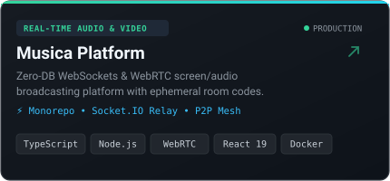
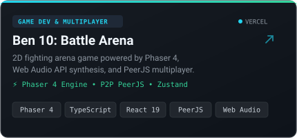
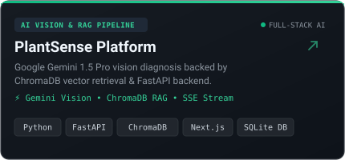
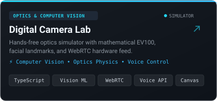
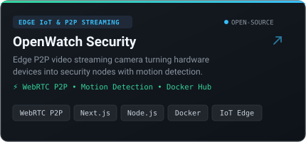
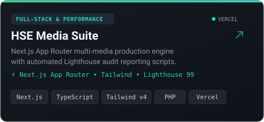

<div align="center">

<!-- Hero Banner -->


<br/><br/>

<!-- Animated Typing Introduction -->
<a href="https://github.com/PackhunterforCynic">
  
</a>

<br/>

<!-- Quick Connect & Status Badges -->
<p align="center">
  <a href="https://robinsonj.vercel.app"></a>
  <a href="https://linkedin.com/in/robinson-mj"></a>
  <a href="mailto:robinson30122000@gmail.com"></a>
  <a href="https://github.com/PackhunterforCynic"></a>
</p>

</div>

---

### 👨‍💻 About Me

```zsh
~/packhunter (main) $ cat about-me.json
```

```json
{
  "name": "Robinson J.",
  "handle": "PackhunterforCynic",
  "education": "Master of Computer Applications (MCA, 2025)",
  "specialization": "Full-Stack Web Systems, Real-Time Networking & AI Vision",
  "core_philosophy": "Building at the intersection of software, data and intelligent systems",
  "location": "Bengaluru, India"
}
```

I am a **Software Engineer and Creative Technologist** with a postgraduate background in Computer Applications (MCA 2025). My engineering focus centers on architecting **scalable full-stack applications**, **zero-database real-time media streaming platforms**, **interactive game engine systems**, and **retrieval-augmented AI pipelines**.

- 🔭 **Architecting Real-Time Systems:** Designed and deployed **Musica**, an ephemeral zero-database watch party and audio/screen-sharing platform utilizing WebRTC mesh and Socket.IO relays.
- 🎮 **Game Development & P2P:** Built **Ben 10: Alien Battle Arena**, a high-performance 2D fighter with Phaser 4, React 19, PeerJS P2P multiplayer, and Web Audio API synthesis.
- 🧠 **AI & Machine Learning:** Developed **PlantSense**, a botanical health diagnostic suite running Google Gemini 1.5 Pro Vision with a ChromaDB vector RAG pipeline and FastAPI backend.
- 📷 **Optics & Computer Vision:** Created **CAMX (Digital Camera Lab)**, modeling mathematical photographic exposure ($EV_{100}$), real-time facial landmark tracking, and hands-free voice control.
- 🌐 **Clean Code & Systems Architecture:** Grounded in strong computer science principles—data structures, normalized schemas, modular RESTful APIs, and responsive design systems.

---

### 🛠️ Technical Arsenal

<div align="center">

#### Programming Languages


#### Frontend Engineering & Graphics


#### Backend, Real-Time & Streaming


#### AI, Machine Learning & Databases


#### Systems, DevOps & Tooling


</div>

---

### 🚀 Featured Engineering Showcase

<table>
  <tr>
    <td width="50%" valign="top">
      <a href="https://github.com/PackhunterforCynic/musica">
        
      </a>
      <br/>
      <b>📡 Musica Platform</b> • <a href="https://musica-apvs.vercel.app"><b>Live Demo ↗</b></a>
      <p>Ephemeral zero-database audio and screen-sharing network. Built with a modular TypeScript monorepo, Socket.IO signaling router, WebRTC mesh topologies, and 4-character room codes.</p>
      <code>TypeScript</code> • <code>Node.js</code> • <code>WebRTC</code> • <code>Socket.IO</code> • <code>React 19</code> • <code>Docker</code>
    </td>
    <td width="50%" valign="top">
      <a href="https://github.com/PackhunterforCynic/game">
        
      </a>
      <br/>
      <b>🎮 Ben 10: Alien Battle Arena</b> • <a href="https://game-rovenor.vercel.app"><b>Live Demo ↗</b></a>
      <p>High-speed 2D fighting arena game. Features custom physics collisions in Phaser 4, procedural sound synthesis via Web Audio API, PeerJS P2P multiplayer, and React 19 state synchronization.</p>
      <code>Phaser 4</code> • <code>TypeScript</code> • <code>React 19</code> • <code>PeerJS</code> • <code>Tailwind v4</code> • <code>Web Audio</code>
    </td>
  </tr>
  <tr>
    <td width="50%" valign="top">
      
      <br/>
      <b>🌱 PlantSense AI Platform</b>
      <p>AI-driven botanical diagnostic system preventing hallucinations through a ChromaDB vector RAG pipeline. Processes image symptoms with Gemini 1.5 Pro Vision and streams diagnoses via SSE.</p>
      <code>Python</code> • <code>FastAPI</code> • <code>Gemini Vision</code> • <code>ChromaDB RAG</code> • <code>Next.js</code> • <code>SQLite</code>
    </td>
    <td width="50%" valign="top">
      
      <br/>
      <b>📷 Digital Camera Lab (CAMX)</b>
      <p>Interactive scientific optics simulator and hands-free photography studio. Features mathematical exposure metering ($EV_{100}$), facial landmark tracking, and continuous voice control.</p>
      <code>Computer Vision</code> • <code>TypeScript</code> • <code>WebRTC Feed</code> • <code>Voice API</code> • <code>Optics Physics</code>
    </td>
  </tr>
  <tr>
    <td width="50%" valign="top">
      
      <br/>
      <b>🔒 OpenWatch Security</b>
      <p>Free, edge-based security camera system transforming any smartphone or desktop into an encrypted surveillance node. Features WebRTC P2P direct streaming and client-side motion detection.</p>
      <code>WebRTC P2P</code> • <code>Node.js Signaling</code> • <code>Next.js</code> • <code>Motion Detection</code> • <code>Docker</code>
    </td>
    <td width="50%" valign="top">
      <a href="https://github.com/PackhunterforCynic/hse">
        
      </a>
      <br/>
      <b>🎬 HSE Production Engine</b> • <a href="https://hse-indol.vercel.app"><b>Live Demo ↗</b></a>
      <p>High-performance agency multimedia production engine. Architected with Next.js App Router, custom Lighthouse performance monitoring scripts, and sub-second page delivery.</p>
      <code>Next.js</code> • <code>TypeScript</code> • <code>Tailwind CSS</code> • <code>Lighthouse 99</code> • <code>PHP</code> • <code>Vercel</code>
    </td>
  </tr>
</table>

---

### 📊 GitHub Activity & Metrics

<div align="center">

<table>
  <tr>
    <td width="50%" align="center">
      
    </td>
    <td width="50%" align="center">
      
    </td>
  </tr>
  <tr>
    <td colspan="2" align="center">
      
    </td>
  </tr>
</table>

#### Contribution Graph Animation
<picture>
  <source media="(prefers-color-scheme: dark)" srcset="https://raw.githubusercontent.com/PackhunterforCynic/PackhunterforCynic/output/github-contribution-grid-snake-dark.svg">
  <source media="(prefers-color-scheme: light)" srcset="https://raw.githubusercontent.com/PackhunterforCynic/PackhunterforCynic/output/github-contribution-grid-snake.svg">
  
</picture>

</div>

---

### 💼 Professional Certifications

- 🏅 **AWS Cloud Foundations** — Cloud Infrastructure, Storage & Security Architecture
- 🌐 **CCNA 200-301 (Network Fundamentals)** — IP Routing, Switching & Network Topologies
- 🍃 **MongoDB Certified** — Schema Design, Indexing & Aggregation Pipelines
- 🧪 **API Testing & Postman** — Automated Contract Verification & Integration Tests
- 📊 **AI & Machine Learning with Python** — scikit-learn, Pandas & Data Modeling

---

### 📬 Connect & Collaborate

I am open to software engineering roles, high-impact contract engagements, and open-source collaborations.

```zsh
~/packhunter (main) $ ./contact --send-inquiry
```

<div align="center">

| Channel | Destination | Verified Handle |
| :--- | :--- | :--- |
| 🌐 **Portfolio** | [robinsonj.vercel.app](https://robinsonj.vercel.app) | `Robinson J.` |
| 💼 **LinkedIn** | [linkedin.com/in/robinson-mj](https://linkedin.com/in/robinson-mj) | `robinson-mj` |
| 📧 **Direct Email** | [robinson30122000@gmail.com](mailto:robinson30122000@gmail.com) | `robinson30122000` |
| 🐙 **GitHub** | [github.com/PackhunterforCynic](https://github.com/PackhunterforCynic) | `@PackhunterforCynic` |

<br/>

<!-- Custom SVG Footer -->


</div>
