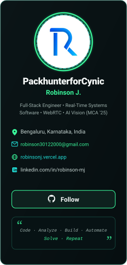

 

 

<table width="100%" border="0" cellspacing="0" cellpadding="0">
<tr>
<td width="25%" valign="top" align="center">

</td>
<td width="49%" valign="top">

 

<table width="100%" border="0" cellspacing="4" cellpadding="0">
<tr>
<td width="50%" valign="top">

</td>
<td width="50%" valign="top">

</td>
</tr>
<tr>
<td width="50%" valign="top">

</td>
<td width="50%" valign="top">

</td>
</tr>
<tr>
<td width="50%" valign="top">

</td>
<td width="50%" valign="top">

</td>
</tr>
</table>
</td>
<td width="26%" valign="top">

 

</td>
</tr>
</table>

 

<table width="100%" border="0" cellspacing="6" cellpadding="0">
<tr>
<td width="40%" valign="top">

<picture>
<source media="(prefers-color-scheme: dark)" srcset="https://raw.githubusercontent.com/PackhunterforCynic/PackhunterforCynic/output/github-contribution-grid-snake-dark.svg">
<source media="(prefers-color-scheme: light)" srcset="https://raw.githubusercontent.com/PackhunterforCynic/PackhunterforCynic/output/github-contribution-grid-snake.svg">

</picture>
</td>
<td width="32%" valign="top">

</td>
<td width="28%" valign="top" align="center">
<table width="100%" border="0" cellspacing="0" cellpadding="0" style="background-color: #0B1517; border-radius: 10px; border: 1.2px solid #174D43;">
<tr>
<td colspan="4">

</td>
</tr>
<tr>
<td align="center" style="padding: 18px 4px 24px 8px;">

</td>
<td align="center" style="padding: 18px 4px 24px 4px;">

</td>
<td align="center" style="padding: 18px 4px 24px 4px;">

</td>
<td align="center" style="padding: 18px 8px 24px 4px;">

</td>
</tr>
</table>
</td>
</tr>
</table>

 

