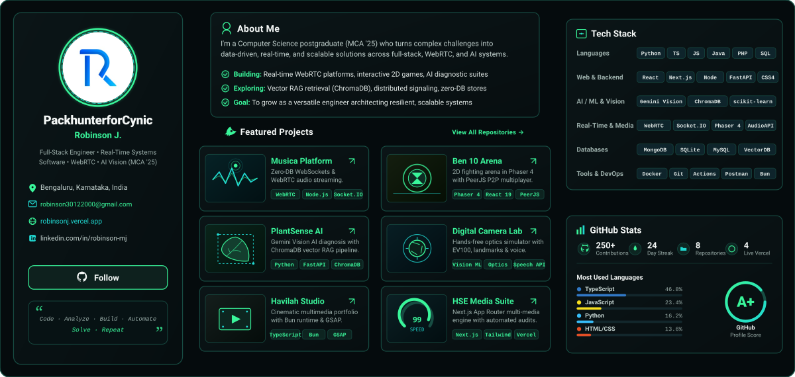
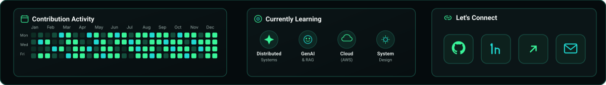

<!-- Hero Banner (Futuristic Developer Workstation) -->

 

<!-- Status & Disciplines Navigation Pills -->

 

<!-- Main Developer Dashboard (3-Column Layout: Profile | About & Projects | Tech Stack & Stats) -->

 

<!-- Bottom Dashboard Panels (Contribution Activity | Currently Learning | Let's Connect) -->

 

---

### 🚀 Interactive Project Navigation & Verified Links

| Project | Primary Domain | Stack | Verified Links |
| :--- | :--- | :--- | :--- |
| **📡 Musica Platform** | Real-Time Audio & Video | `TypeScript` • `Node.js` • `WebRTC` • `Socket.IO` • `Docker` | [**Live Demo ↗**](https://musica-apvs.vercel.app) • [**GitHub Repo ↗**](https://github.com/PackhunterforCynic/musica) |
| **🎮 Ben 10: Battle Arena** | 2D Game Dev & P2P | `Phaser 4` • `React 19` • `TypeScript` • `PeerJS` • `Web Audio` | [**Live Game ↗**](https://game-rovenor.vercel.app) • [**GitHub Repo ↗**](https://github.com/PackhunterforCynic/game) |
| **🌱 PlantSense AI** | AI Botanical Health | `Python` • `FastAPI` • `Gemini Vision AI` • `ChromaDB RAG` | [**FastAPI Backend**](https://github.com/PackhunterforCynic) • [**Showcase**](https://robinsonj.vercel.app) |
| **📷 Digital Camera Lab** | Optics & Computer Vision | `TypeScript` • `WebRTC` • `Optics Physics` • `Voice API` | [**Optics Simulator**](https://github.com/PackhunterforCynic) • [**Showcase**](https://robinsonj.vercel.app) |
| **🎥 Havilah Studio** | Cinematic Multimedia | `TypeScript` • `Bun` • `React` • `GSAP` • `Vercel` | [**Live Demo ↗**](https://havilah-alpha.vercel.app) • [**GitHub Repo ↗**](https://github.com/PackhunterforCynic/havilah) |
| **🎬 HSE Media Suite** | Full-Stack Performance | `Next.js App Router` • `Tailwind CSS v4` • `PHP` • `Lighthouse 99` | [**Live Demo ↗**](https://hse-indol.vercel.app) • [**GitHub Repo ↗**](https://github.com/PackhunterforCynic/hse) |

 

<!-- Quick Connect Badges -->

  

<!-- Custom Neon-Green SVG Footer -->

