

<!-- Hero Banner -->

 

<!-- Status Pills Bar -->

 

<!-- Main Dashboard Grid (3-Column Layout Matching Visual Reference) -->
<table width="100%" border="0" cellspacing="0" cellpadding="0">
  <tr>
    <!-- LEFT COLUMN: Profile Card (~24% width) -->
    <td width="24%" valign="top" align="center">
      <table width="100%" border="0" cellspacing="0" cellpadding="0">
        <tr>
          <td align="center">
            
            <h2 align="center" style="margin: 8px 0 2px 0;">
              <a href="https://github.com/PackhunterforCynic" style="text-decoration: none; color: #F4F7F6;">PackhunterforCynic</a>
            </h2>
            

              Robinson J.
            

            

              <b>Software Engineer</b> • <b>Real-Time Systems</b> 
              Full-Stack • AI Vision • IoT (MCA '25)
            

            

              
📍 Bengaluru, Karnataka, India

              
✉️ <a href="mailto:robinson30122000@gmail.com" style="color: #39F59A; text-decoration: none;">robinson30122000@gmail.com</a>

              
🌐 <a href="https://robinsonj.vercel.app" style="color: #20D9D2; text-decoration: none;">robinsonj.vercel.app</a>

              
💼 <a href="https://linkedin.com/in/robinson-mj" style="color: #C3D2CF; text-decoration: none;">linkedin.com/in/robinson-mj</a>

            

            
              
            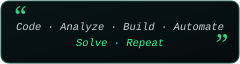
          </td>
        </tr>
      </table>
    </td>

    <!-- CENTER COLUMN: About Me & Featured Projects (~48% width) -->
    <td width="48%" valign="top">
      <table width="100%" border="0" cellspacing="0" cellpadding="0">
        <!-- About Me Card -->
        <tr>
          <td>
            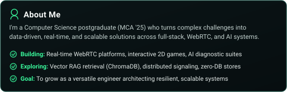
          </td>
        </tr>
        <tr><td> </td></tr>
        <!-- Featured Projects Header -->
        <tr>
          <td>
            
          </td>
        </tr>
        <!-- 2-Column Projects Grid -->
        <tr>
          <td>
            <table width="100%" border="0" cellspacing="4" cellpadding="0">
              <tr>
                <td width="50%" valign="top">
                  <a href="https://github.com/PackhunterforCynic/musica">
                    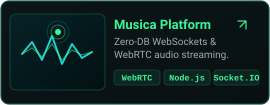
                  </a>
                </td>
                <td width="50%" valign="top">
                  <a href="https://github.com/PackhunterforCynic/game">
                    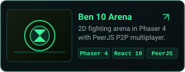
                  </a>
                </td>
              </tr>
              <tr>
                <td width="50%" valign="top">
                  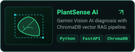
                </td>
                <td width="50%" valign="top">
                  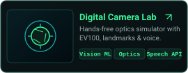
                </td>
              </tr>
              <tr>
                <td width="50%" valign="top">
                  
                </td>
                <td width="50%" valign="top">
                  <a href="https://github.com/PackhunterforCynic/hse">
                    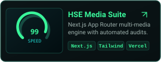
                  </a>
                </td>
              </tr>
            </table>
          </td>
        </tr>
      </table>
    </td>

    <!-- RIGHT COLUMN: Tech Stack & GitHub Stats (~28% width) -->
    <td width="28%" valign="top">
      <table width="100%" border="0" cellspacing="0" cellpadding="0">
        <!-- Tech Stack Card -->
        <tr>
          <td>
            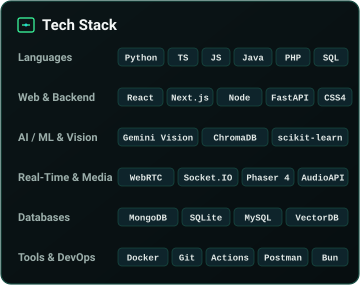
          </td>
        </tr>
        <tr><td> </td></tr>
        <!-- GitHub Stats Card -->
        <tr>
          <td>
            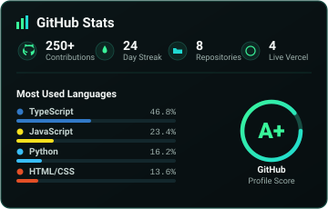
          </td>
        </tr>
      </table>
    </td>
  </tr>
</table>

 

<!-- Bottom Dashboard: 3 Visually Consistent Panels -->
<table width="100%" border="0" cellspacing="6" cellpadding="0">
  <tr>
    <!-- Panel A: Contribution Activity (~40% width) -->
    <td width="40%" valign="top">
      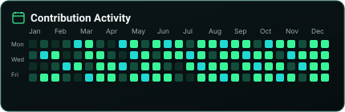
      <picture>
        <source media="(prefers-color-scheme: dark)" srcset="https://raw.githubusercontent.com/PackhunterforCynic/PackhunterforCynic/output/github-contribution-grid-snake-dark.svg">
        <source media="(prefers-color-scheme: light)" srcset="https://raw.githubusercontent.com/PackhunterforCynic/PackhunterforCynic/output/github-contribution-grid-snake.svg">
        
      </picture>
    </td>

    <!-- Panel B: Currently Learning (~32% width) -->
    <td width="32%" valign="top">
      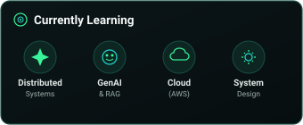
    </td>

    <!-- Panel C: Let's Connect (~28% width) -->
    <td width="28%" valign="top" align="center">
      <table width="100%" border="0" cellspacing="0" cellpadding="0" style="background-color: #0B1517; border-radius: 10px; border: 1.2px solid #174D43;">
        <tr>
          <td colspan="4">
            
          </td>
        </tr>
        <tr>
          <td align="center" style="padding: 18px 4px 24px 8px;">
            
          </td>
          <td align="center" style="padding: 18px 4px 24px 4px;">
            <a href="https://linkedin.com/in/robinson-mj" title="LinkedIn">
              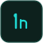
            </a>
          </td>
          <td align="center" style="padding: 18px 4px 24px 4px;">
            
          </td>
          <td align="center" style="padding: 18px 8px 24px 4px;">
            
          </td>
        </tr>
      </table>
    </td>
  </tr>
</table>

 

<!-- Custom Neon-Green SVG Footer -->

  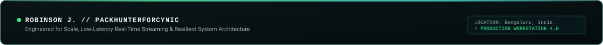

